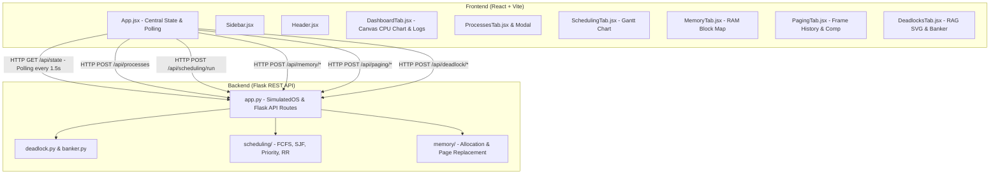

# Virtual OS Dashboard — Codebase Architecture & File Documentation

This document provides a comprehensive explanation of every file and directory across both the **Backend (Python / Flask)** and **Frontend (React + Vite)** in the **Virtual OS Dashboard** repository.

---

## 🏗️ High-Level System Architecture

The project simulates core Operating System subsystems in real time:



---

## 📁 Repository Structure Overview

```
virtual-os-dashboard/
├── backend/                        # Python Flask REST API & OS Simulator core
│   ├── app.py                      # Central Flask app & SimulatedOS coordinator
│   ├── banker.py                   # Banker's Algorithm (Safety & Request)
│   ├── deadlock.py                 # Deadlock detection & DeadlockManager
│   ├── scheduling/                 # CPU Scheduling Subsystem
│   │   ├── __init__.py             # Scheduling module exports
│   │   ├── models.py               # Process & GanttEntry data models
│   │   ├── scheduler.py            # FCFS, SJF, Priority, Round Robin dispatcher
│   │   ├── metrics.py              # Turnaround, waiting, response time calculations
│   │   └── example.py             # Standalone CLI example
│   └── memory/                     # Memory & Virtual Paging Subsystem
│       ├── __init__.py             # Memory module exports
│       ├── allocation.py           # First, Best, Worst Fit & Coalescing Engine
│       ├── page_replacement.py     # FIFO, LRU, Optimal algorithms & history
│       └── statistics.py           # Fragmentation, utilization & algorithm comparison
├── frontend/                       # React (Vite) Single Page Application
│   ├── index.html                  # HTML entry point mounting React root
│   ├── vite.config.js              # Vite build & proxy configuration
│   ├── package.json                # React dependencies and build scripts
│   ├── src/                        # React source code
│   │   ├── main.jsx                # React DOM root entry
│   │   ├── App.jsx                 # Master application controller & state
│   │   ├── style.css               # Complete dark-mode CSS design system
│   │   ├── utils.js                # Process color mappings and utilities
│   │   └── components/             # Modular UI components
│   │       ├── Sidebar.jsx         # 6-tab navigation & system indicator
│   │       ├── Header.jsx          # Dynamic titles & Deadlock badge
│   │       ├── DashboardTab.jsx    # Real-time CPU canvas & event log
│   │       ├── ProcessesTab.jsx    # Process inspection & delete table
│   │       ├── CreateProcessModal.jsx # New process creation modal dialog
│   │       ├── SchedulingTab.jsx   # Dispatcher controls & Gantt chart
│   │       ├── MemoryTab.jsx       # Dynamic memory map & block table
│   │       ├── PagingTab.jsx       # Frame simulator & side-by-side compare
│   │       ├── DeadlocksTab.jsx    # Banker's safety, requests & SVG RAG
│   │       └── ToastContainer.jsx  # Auto-dismissing notification toasts
│   ├── dist/                       # Pre-compiled static production bundle
│   ├── dashboard.vanilla.js        # Legacy vanilla JavaScript backup
│   └── index.vanilla.html          # Legacy vanilla HTML backup
├── tests/                          # Automated Pytest Suite (46 Tests)
│   ├── test_api.py                 # REST API integration tests (9 tests)
│   ├── test_scheduling.py          # CPU algorithm dispatcher tests (12 tests)
│   ├── test_deadlock.py            # Deadlock & Banker's tests (9 tests)
│   ├── test_memory_allocation.py   # Partition allocation tests (5 tests)
│   ├── test_page_replacement.py    # Paging replacement tests (8 tests)
│   └── test_memory_statistics.py   # Stats & comparative tests (3 tests)
├── requirements.txt                # Python runtime dependencies (Flask, pytest)
├── pytest.ini                      # Python path configuration for tests
└── README.md                       # Project setup, execution & API guide
```

---

## 🐍 Backend Files Explained

### 1. [`backend/app.py`](file:///Users/anushkagattani/virtual-os-dashboard/backend/app.py)
- **Role**: Main application entry point and central coordinator.
- **Key Responsibilities**:
  - Defines the `SimulatedOS` class which aggregates all subsystems: active processes, `MemoryManager`, `DeadlockManager`, and paging state.
  - Generates sequential unique PIDs (`P1`, `P2`, `P3`...).
  - Synchronizes process lifecycles: when a process is created or terminated, automatically allocates or frees physical memory and updates resource claim matrices.
  - Exposes all REST API endpoints under `/api/...` (Process CRUD, Scheduling, Memory, Paging, and Deadlock).
  - Handles CORS preflight headers (`OPTIONS`) so the Vite development server (`localhost:5173`) can communicate directly with Flask (`localhost:5000`).
  - Implements smart static file serving: automatically serves the compiled React application from [`frontend/dist/`](file:///Users/anushkagattani/virtual-os-dashboard/frontend/dist/) or falls back to `frontend/`.

### 2. [`backend/banker.py`](file:///Users/anushkagattani/virtual-os-dashboard/backend/banker.py)
- **Role**: Implementation of Dijkstra's classic **Banker's Algorithm** for Deadlock Avoidance.
- **Key Classes / Functions**:
  - `BankersAlgorithm`: Validates resource vectors and matrices (`total_resources`, `allocation`, `maximum`, `need`, `available`).
  - `is_safe()`: Executes the safety algorithm. Finds a safe sequence of processes where `Need <= Work`, releasing allocations progressively. Returns a boolean and the safe sequence (e.g., `["P1", "P2", "P3"]`).
  - `request_resources(pid, request)`: Executes the Resource Request Algorithm. Validates that `Request <= Need` and `Request <= Available`. Temporarily allocates resources and runs the safety check; if safe, commits the allocation; if unsafe, rolls back the state and denies the request.

### 3. [`backend/deadlock.py`](file:///Users/anushkagattani/virtual-os-dashboard/backend/deadlock.py)
- **Role**: Deadlock detection and high-level deadlock state coordination.
- **Key Classes / Functions**:
  - `detect_deadlock(processes, resources, available, allocation, request)`: Multi-instance deadlock detection algorithm based on Silberschatz & Galvin. Identifies deadlocked processes and blocked resources.
  - `DeadlockManager`: High-level wrapper maintaining authoritative matrices (`allocation`, `maximum`, `need`). Automatically synchronizes with the active process list (`sync_with_processes`). Generates structured summaries for the frontend dashboard and RAG visualization.

### 4. [`backend/scheduling/models.py`](file:///Users/anushkagattani/virtual-os-dashboard/backend/scheduling/models.py)
- **Role**: Data structures for process scheduling.
- **Key Classes**:
  - `Process`: Represents a simulated task with `pid`, `name`, `arrival_time`, `burst_time`, `priority`, `memory_required`, `state` (`READY`, `RUNNING`, `WAITING`, `TERMINATED`), and timing counters (`start_time`, `completion_time`, `waiting_time`, `turnaround_time`, `response_time`).
  - `GanttEntry`: Represents an executed time slice on the CPU with `pid`, `start`, `end`, and `duration`.

### 5. [`backend/scheduling/scheduler.py`](file:///Users/anushkagattani/virtual-os-dashboard/backend/scheduling/scheduler.py)
- **Role**: Core CPU scheduling dispatchers.
- **Key Algorithms**:
  - `schedule(processes, algorithm, quantum)`: Unified dispatcher function supporting:
    - **FCFS** (First-Come, First-Served): Non-preemptive, strictly ordered by arrival time.
    - **SJF** (Shortest Job First): Non-preemptive, selects available process with shortest burst time.
    - **Priority**: Non-preemptive, selects available process with highest priority (lower numerical value = higher priority).
    - **Round Robin (RR)**: Preemptive scheduling with a configurable time quantum. Rotates through a ready queue, preempting running processes when their slice expires.
  - Automatically inserts **IDLE** time blocks into the Gantt chart if no process has arrived at current CPU time.

### 6. [`backend/scheduling/metrics.py`](file:///Users/anushkagattani/virtual-os-dashboard/backend/scheduling/metrics.py)
- **Role**: Statistical calculations for scheduling performance.
- **Metrics Computed**:
  - Per-process and average **Turnaround Time** ($Completion - Arrival$).
  - Per-process and average **Waiting Time** ($Turnaround - Burst$).
  - Per-process and average **Response Time** ($Start - Arrival$).
  - Overall **CPU Utilization Percentage** ($\frac{\text{Busy Time}}{\text{Total Elapsed Time}} \times 100$).

### 7. [`backend/scheduling/example.py`](file:///Users/anushkagattani/virtual-os-dashboard/backend/scheduling/example.py)
- **Role**: Standalone demonstration script showing how to instantiate processes and run scheduler algorithms directly in Python.

### 8. [`backend/memory/allocation.py`](file:///Users/anushkagattani/virtual-os-dashboard/backend/memory/allocation.py)
- **Role**: Dynamic partition memory management.
- **Key Classes / Functions**:
  - `MemoryBlock`: Represents a contiguous block of RAM (`start`, `size`, `is_allocated`, `process_id`, `color`).
  - `MemoryManager`: Manages a 1024 MB memory space.
    - `allocate(pid, size, strategy)`: Implements **First Fit**, **Best Fit**, and **Worst Fit** partition search. Splits oversized free blocks.
    - `deallocate(pid)`: Releases memory occupied by a process.
    - `coalesce()`: Merges adjacent free memory blocks together to prevent false external fragmentation.

### 9. [`backend/memory/page_replacement.py`](file:///Users/anushkagattani/virtual-os-dashboard/backend/memory/page_replacement.py)
- **Role**: Virtual memory page replacement simulation.
- **Key Algorithms**:
  - `fifo(reference_string, frame_count)`: First-In, First-Out page replacement.
  - `lru(reference_string, frame_count)`: Least Recently Used page replacement using timestamp / recency tracking.
  - `optimal(reference_string, frame_count)`: Belady's Optimal algorithm; replaces the page that will not be used for the longest period in the future.
  - Outputs a complete step-by-step frame history log showing frame contents at each page reference, hit/fault status, replaced page, and human-readable explanation.

### 10. [`backend/memory/statistics.py`](file:///Users/anushkagattani/virtual-os-dashboard/backend/memory/statistics.py)
- **Role**: Memory and paging metrics engine.
- **Key Functions**:
  - `calculate_memory_stats(memory_mgr)`: Computes used RAM, free RAM, utilization percentage, and external fragmentation (sum of free blocks that cannot satisfy an allocation).
  - `compare_page_replacement(reference_string, frame_count)`: Runs FIFO, LRU, and Optimal simultaneously on identical inputs to provide side-by-side benchmarking and determine the best-performing algorithm.

---

## ⚛️ Frontend Files Explained (React + Vite)

### 1. [`frontend/index.html`](file:///Users/anushkagattani/virtual-os-dashboard/frontend/index.html)
- **Role**: The Single Page Application HTML root shell.
- **Details**: Loads Google Fonts (`Inter` for UI typography and `Fira Code` for monospace figures/addresses), defines the `<body class="dark-theme">`, provides `<div id="root"></div>`, and loads [`src/main.jsx`](file:///Users/anushkagattani/virtual-os-dashboard/frontend/src/main.jsx).

### 2. [`frontend/vite.config.js`](file:///Users/anushkagattani/virtual-os-dashboard/frontend/vite.config.js)
- **Role**: Vite development server and build configuration.
- **Details**: Uses `@vitejs/plugin-react`. Configures the proxy so that any API call to `/api/...` during `npm run dev` is automatically forwarded to Flask at `http://127.0.0.1:5000`.

### 3. [`frontend/package.json`](file:///Users/anushkagattani/virtual-os-dashboard/frontend/package.json)
- **Role**: Project dependencies and npm scripts (`dev`, `build`, `lint`, `preview`).
- **Dependencies**: React 19, React-DOM 19, Vite, `@vitejs/plugin-react`.

### 4. [`frontend/src/main.jsx`](file:///Users/anushkagattani/virtual-os-dashboard/frontend/src/main.jsx)
- **Role**: React client entry point that mounts the `<App />` component into the DOM root using `ReactDOM.createRoot`.

### 5. [`frontend/src/App.jsx`](file:///Users/anushkagattani/virtual-os-dashboard/frontend/src/App.jsx)
- **Role**: The master application controller and state orchestrator.
- **Key Responsibilities**:
  - Coordinates global state: active tab, system state snapshot from `/api/state`, CPU history buffer (last 25 ticks), active toast messages, and event logs.
  - Implements auto-polling: queries `/api/state` every 1.5 seconds to refresh the dashboard in real time.
  - Listens to browser URL hash changes (`#dashboard`, `#processes`, `#scheduling`, etc.) for direct tab navigation.
  - Implements all API action handlers (Process creation/deletion, Scheduling simulation, Memory strategy/reset, Paging simulation/comparison, Banker's check, and Resource requests).

### 6. [`frontend/src/style.css`](file:///Users/anushkagattani/virtual-os-dashboard/frontend/src/style.css)
- **Role**: Complete dark-theme design system.
- **Details**: Defines CSS tokens (`--bg-main`, `--bg-sidebar`, `--bg-card`, `--accent-blue`, `--accent-green`, `--accent-purple`, `--accent-red`), custom scrollbars, animations (`pulse`, `fadeIn`, `slideDown`), responsive grid systems, badge states, and table styles.

### 7. [`frontend/src/utils.js`](file:///Users/anushkagattani/virtual-os-dashboard/frontend/src/utils.js)
- **Role**: Visual helper utilities.
- **Details**: Exports `PROC_COLORS` palette (8 curated modern accent colors) and `getProcessColor(pid)` to ensure consistent color tagging across Gantt chart slices and memory partition blocks.

### 8. Components Directory ([`frontend/src/components/`](file:///Users/anushkagattani/virtual-os-dashboard/frontend/src/components/))

#### a. [`Sidebar.jsx`](file:///Users/anushkagattani/virtual-os-dashboard/frontend/src/components/Sidebar.jsx)
- Renders the 250px left sidebar with OS branding, gradient icon, 6 tab navigation items with custom inline SVGs, and a live pulse indicator showing system health (`System Active` or `API Connection Error`).

#### b. [`Header.jsx`](file:///Users/anushkagattani/virtual-os-dashboard/frontend/src/components/Header.jsx)
- Top bar that dynamically updates the page title and subtitle as the user switches tabs. Displays the live Deadlock Status Badge (`SAFE STATE` in green, `WARNING STATE` in amber, `DEADLOCK STATE` in red) and the "Sync State" button.

#### c. [`DashboardTab.jsx`](file:///Users/anushkagattani/virtual-os-dashboard/frontend/src/components/DashboardTab.jsx)
- **Tab 1 — Home Overview**:
  - 5 Metric summary cards: CPU Usage (%), Memory Usage (MB), Active Processes count, Page Fault count, and Deadlock state.
  - Real-time **CPU Activity Monitor**: An HTML5 `<canvas>` line graph rendered with background grid lines, anti-aliased curves, and a vertical linear gradient.
  - **System Event Log**: Timestamped, scrollable event journal with a "Clear" button.
  - Active Processes overview table.

#### d. [`ProcessesTab.jsx`](file:///Users/anushkagattani/virtual-os-dashboard/frontend/src/components/ProcessesTab.jsx)
- **Tab 2 — Process Management**:
  - Full process inspection table showing PID, Name, Arrival, Burst, Priority, Memory requirement, and State badge.
  - Includes "Delete" action button per process (triggers confirmation and frees all associated RAM and resource claims).

#### e. [`CreateProcessModal.jsx`](file:///Users/anushkagattani/virtual-os-dashboard/frontend/src/components/CreateProcessModal.jsx)
- Pop-up modal dialog for creating simulated processes with fields for name, arrival time, burst time, priority, memory requirement, and Banker's Algorithm maximum resource claims (CPU, Printer, Disk, Network).

#### f. [`SchedulingTab.jsx`](file:///Users/anushkagattani/virtual-os-dashboard/frontend/src/components/SchedulingTab.jsx)
- **Tab 3 — CPU Scheduling**:
  - Dispatcher controls for FCFS, SJF, Priority, and Round Robin (with dynamic Time Quantum input).
  - Interactive **Gantt Chart**: Horizontal timeline bar with proportional process slices, distinct colors per PID, and time axis tick markers.
  - 4 Timing Metrics summary cards (Average Waiting, Turnaround, Response, CPU Utilization).
  - Per-process timing breakdown table.

#### g. [`MemoryTab.jsx`](file:///Users/anushkagattani/virtual-os-dashboard/frontend/src/components/MemoryTab.jsx)
- **Tab 4 — Memory Management**:
  - Strategy selector (First Fit, Best Fit, Worst Fit) and "Reset Memory" action.
  - 5 Stats cards (Total, Used, Free, Utilization %, External Fragmentation).
  - **Physical Memory Allocation Map**: Visual bar showing RAM partitions, process assignments, and free blocks with proportional widths and legend.
  - Partition Blocks status table (Start Address, End Address, Size, Status, Process ID).

#### h. [`PagingTab.jsx`](file:///Users/anushkagattani/virtual-os-dashboard/frontend/src/components/PagingTab.jsx)
- **Tab 5 — Virtual Memory & Paging**:
  - Form accepting custom reference strings, frame counts, and algorithm selection (FIFO, LRU, Optimal).
  - "COMPARE ALL" action running all three algorithms concurrently, rendering a comparative performance table with a `BEST` algorithm tag.
  - Current Page Frames grid visually displaying the state of each frame.
  - Step-by-Step Page Frame History Log detailing page references, hits, faults, and replacement reasons.

#### i. [`DeadlocksTab.jsx`](file:///Users/anushkagattani/virtual-os-dashboard/frontend/src/components/DeadlocksTab.jsx)
- **Tab 6 — Deadlock Avoidance & Detection**:
  - System status banner with one-click actions: "RUN SAFETY CHECK" and "DETECT DEADLOCK".
  - Available Resources cards for CPU, Printer, Disk, and Network.
  - 3 Resource Matrices: Allocation Matrix, Maximum Matrix, and Need Matrix ($Max - Alloc$).
  - Banker's Safety result box with safe sequence chips (`P1 → P2 → P3`).
  - Resource Request simulation form for testing hypothetical allocations.
  - **Resource Allocation Graph (RAG)**: Interactive SVG displaying Process circle nodes on the left, Resource square nodes on the right, solid green allocation edges, and dashed amber request edges.

#### j. [`ToastContainer.jsx`](file:///Users/anushkagattani/virtual-os-dashboard/frontend/src/components/ToastContainer.jsx)
- Displays floating notifications (success, warning, error, info) that auto-dismiss after 4 seconds.

---

## 🔌 Complete REST API Reference

| Method | Endpoint | Description | Key Request / Response Data |
|---|---|---|---|
| `GET` | `/api/state` | Returns the aggregated OS state snapshot | `{ cpu, memory, paging, processes, deadlock }` |
| `GET` | `/api/processes` | Lists all active processes | Array of process objects |
| `POST` | `/api/processes` | Creates a new simulated process | `{ name, arrival_time, burst_time, priority, memory_required, maximum_resources }` |
| `DELETE` | `/api/processes/<pid>` | Terminates a process and deallocates its RAM | Returns updated process list |
| `POST` | `/api/scheduling/run` | Executes CPU scheduling algorithm | `{ algorithm: "RR", quantum: 2 }` |
| `GET` | `/api/memory/state` | Returns RAM partition state and allocation map | `{ total_mb, used_mb, blocks, allocation_map }` |
| `POST` | `/api/memory/strategy` | Sets allocation strategy | `{ strategy: "first_fit" \| "best_fit" \| "worst_fit" }` |
| `POST` | `/api/memory/reset` | Resets RAM to an unallocated state | `{ message: "Memory reset" }` |
| `GET` | `/api/paging/state` | Returns paging status and frame history | `{ frame_count, page_faults, frame_history }` |
| `POST` | `/api/paging/run` | Runs a page replacement simulation | `{ reference_string, frame_count, algorithm }` |
| `POST` | `/api/paging/compare` | Compares FIFO, LRU, and Optimal on same input | `{ comparison, best_algorithm, detailed_results }` |
| `GET` | `/api/deadlock/state` | Returns resource allocation and need matrices | `{ available, allocation, maximum, need }` |
| `POST` | `/api/deadlock/safety` | Executes Banker's Safety Algorithm | `{ safe: true, safe_sequence: ["P1", "P2"] }` |
| `POST` | `/api/deadlock/request` | Simulates a resource request | `{ process_id: "P1", request: { CPU: 1 } }` |
| `POST` | `/api/deadlock/detect` | Runs multi-instance deadlock detection | `{ deadlock_detected: false, involved_processes: [] }` |

---

## 🧪 Testing Suite Overview

Located in [`tests/`](file:///Users/anushkagattani/virtual-os-dashboard/tests/):

- **[`test_api.py`](file:///Users/anushkagattani/virtual-os-dashboard/tests/test_api.py)** (9 tests): Validates HTTP status codes, process creation, input validation, scheduling, memory, paging, and deadlock endpoints.
- **[`test_scheduling.py`](file:///Users/anushkagattani/virtual-os-dashboard/tests/test_scheduling.py)** (12 tests): Verifies FCFS, SJF, Priority, and Round Robin scheduling math, preemption, idle times, and metric formulas.
- **[`test_deadlock.py`](file:///Users/anushkagattani/virtual-os-dashboard/tests/test_deadlock.py)** (9 tests): Tests Banker's safety check, valid and invalid resource requests, and deadlock detection with cycle identification.
- **[`test_memory_allocation.py`](file:///Users/anushkagattani/virtual-os-dashboard/tests/test_memory_allocation.py)** (5 tests): Tests First Fit, Best Fit, Worst Fit, block splitting, deallocation, and adjacent free block coalescing.
- **[`test_page_replacement.py`](file:///Users/anushkagattani/virtual-os-dashboard/tests/test_page_replacement.py)** (8 tests): Tests FIFO, LRU, Optimal algorithms, Belady's anomaly cases, hit/fault counts, and single-frame edge cases.
- **[`test_memory_statistics.py`](file:///Users/anushkagattani/virtual-os-dashboard/tests/test_memory_statistics.py)** (3 tests): Tests utilization percentage calculations, external fragmentation tracking, and algorithm comparisons.

To run the entire test suite:
```bash
source .venv/bin/activate
pytest -v
# Output: 46 passed in ~0.15s
```
