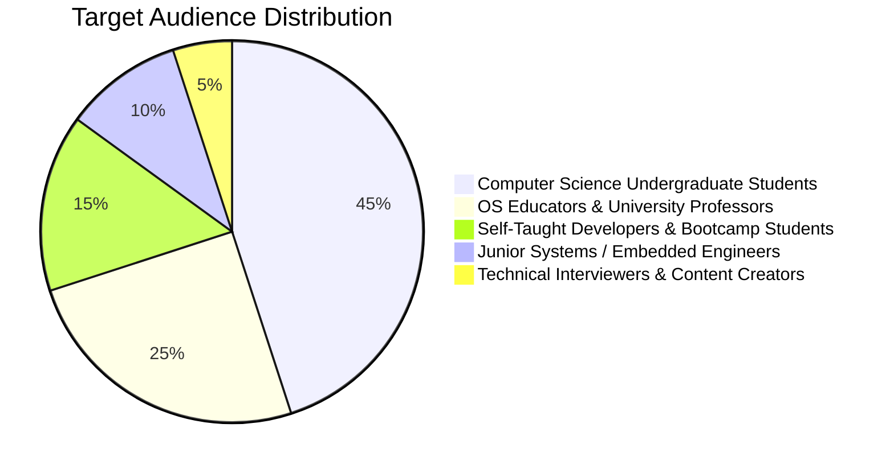

# Virtual OS Dashboard — Comprehensive Project Analysis

> **Document Type:** Project & Research Analysis Report  
> **System Name:** Virtual OS Dashboard (Simulated Core v1.0)  
> **Technologies:** Python 3, Flask REST API, React 19, Vite, HTML5 Canvas, SVG, Vanilla CSS3

---

## Executive Summary

The **Virtual OS Dashboard** is an interactive, full-stack operating system simulation platform. It integrates six foundational OS subsystems into a cohesive real-time web application: **Process Management**, **CPU Scheduling**, **Physical Memory Allocation**, **Virtual Memory Page Replacement**, **Deadlock Avoidance (Banker's Algorithm)**, and **Deadlock Detection with Resource Allocation Graphs (RAG)**.

This document critically evaluates the platform across five core dimensions:
1. **Novelty**
2. **Usage & Practical Applications**
3. **Research Gaps**
4. **Limitations**
5. **Target Audience**

---

## 1. 🌟 Novelty of This Project

Most existing educational OS simulators are either **isolated single-topic scripts** (e.g., a standalone CLI script for SJF or an outdated Java applet for Banker's Algorithm) or **overly complex hardware simulators** (such as gem5 or Bochs) that have prohibitive learning curves and lack accessible visual interfaces. The Virtual OS Dashboard introduces several distinct novelties:

### 1.1 Holistic Cross-Subsystem State Co-Simulation
- **Unified Central State Machine (`SimulatedOS`)**: Instead of treating subsystems in isolation, the platform manages an authoritative central OS state. Creating a process simultaneously:
  - Allocates contiguous physical memory partitions according to the selected strategy (**First Fit, Best Fit, or Worst Fit**).
  - Registers resource claim bounds for **Banker's Algorithm**.
  - Enters the ready queue for **CPU scheduling** dispatchers.
  - Generates nodes and edge relationships inside the **Resource Allocation Graph (RAG)**.
- **Cascading Lifecycle Propagation**: When a process is terminated, the system automatically frees its RAM, coalesces adjacent free memory blocks to eliminate false external fragmentation, releases all held resource instances, and updates safety sequences across the entire OS.

### 1.2 Real-Time Visual Telemetry & Bidirectional Interactivity
- **Real-Time Polling Engine**: The React frontend polls the Flask backend every 1.5 seconds, delivering a live telemetry experience akin to commercial monitoring tools (Datadog, Grafana) for a simulated OS.
- **Dynamic HTML5 Canvas & Vector Rendering**:
  - **Live CPU Monitor**: Canvas-based real-time line graph with history buffers, visual grids, and gradient area fills.
  - **Interactive Resource Allocation Graph (RAG)**: Procedurally generated SVG graph dynamically mapping processes (circles), multi-instance resources (rectangles), active allocation edges (green arrows), and request/need edges (dashed amber arrows).
  - **Animated Proportional Gantt Charts**: Computed CPU timeline slices with milestone tick markers and idle-time resolution.
  - **RAM Memory Allocation Bar**: Proportional block visualization highlighting allocated partitions vs. free fragmented spaces.

### 1.3 Side-by-Side Algorithm Benchmarking Engine
- **Comparative Virtual Memory Evaluation (`compare_page_replacement`)**: Simultaneously executes FIFO, LRU, and Optimal (Belady’s) algorithms on identical page reference strings and frame allocations. The system compares page faults, page hits, and hit ratios, dynamically tagging the mathematically best performer (`BEST`).
- **Live Memory Strategy Re-Allocation**: Users can toggle between First Fit, Best Fit, and Worst Fit on the fly, immediately observing the impact on block placement and external fragmentation metrics.

### 1.4 Speculative Execution & Rollback in Deadlock Management
- **Safe State Exploration**: Implements Banker's Resource Request algorithm with full transactional semantics: requests are tested speculatively by checking if granting them leaves the system in a safe state. If safe, the allocation is committed; if unsafe, state changes are rolled back and denied with explanatory diagnostic feedback.

### 1.5 Modern Full-Stack Decoupled Architecture for Systems Pedagogy
- Replaces legacy command-line or monolithic GUI tools (e.g., Tkinter, Swing) with a clean **Flask REST API + React 19 (Vite) SPA** architecture. The application supports dual-mode deployment: running as a unified zero-configuration Flask app or with high-speed Vite Hot Module Reloading (HMR).

---

## 2. 🎯 Usage of This Project

The Virtual OS Dashboard serves multiple practical and educational purposes across academia and industry:

### 2.1 Higher Education & University Operating Systems Courses
- **Classroom Demonstrations**: Professors can visually demonstrate abstract OS mechanics during lectures (e.g., showing Belady’s anomaly where adding frames increases page faults in FIFO, or illustrating how circular wait creates deadlock cycles in the RAG).
- **Interactive Laboratory Exercises**: Students can test diverse scenarios, such as creating varying process burst profiles to witness the convoy effect in FCFS versus shortest-job prioritization in SJF.
- **Homework & Exam Calculation Verification**: Students can verify manual calculations (turnaround time, waiting time, safe sequence determination, matrix subtraction for Need matrices) against verified algorithmic outputs.

### 2.2 Algorithm Prototyping & Heuristic Exploration
- **Memory Fragmentation Studies**: Exploring how different allocation policies (First Fit vs. Best Fit vs. Worst Fit) lead to external fragmentation over a sequence of variable-sized process arrivals and terminations.
- **Scheduling Quantum Tuning**: Analyzing the trade-off in Round Robin scheduling between small quanta (high context responsiveness, increased preemption) and large quanta (degenerating into FCFS).

### 2.3 Systems Engineering Training & Technical Interviews
- **Candidate Assessment & Training**: Bootcamp instructors and technical interviewers can use the dashboard to test candidate intuition on OS principles (e.g., asking candidates to explain why a given resource request was denied or identifying deadlocks from the graph).
- **Visual Aid for Systems Documentation**: Visualizing memory layout and process synchronization principles for technical articles and presentations.

---

## 3. 🔬 Research Gaps

While the Virtual OS Dashboard bridges the gap between static textbook equations and heavyweight hardware emulators, it highlights several unaddressed research and pedagogical gaps in systems simulation literature:

| Research Gap | Description | Significance |
|---|---|---|
| **Disjoint Pedagogical Simulators vs. Monolithic Kernels** | Traditional research relies on full hardware emulators (gem5, QEMU) which are too opaque for undergraduate theory, or disjoint calculators that isolate algorithms from each other. | There is a lack of lightweight, modular frameworks that demonstrate cross-subsystem ripple effects (e.g., how scheduling delay impacts resource hold times and induces deadlock). |
| **Coupled Virtual Paging & Physical RAM Allocation** | In real kernels (Linux, Windows), virtual memory paging directly feeds into page table structures, TLBs, and physical page frame allocators (Buddy System / Slab). | Most educational simulators simulate paging purely as mathematical string-replacement and physical memory as contiguous byte blocks, without linking virtual address translation to physical frames. |
| **Static Heuristics vs. Adaptive / ML-Driven Policies** | Modern operating systems leverage adaptive scheduling (e.g., Linux CFS with vruntime, multi-level feedback queues with dynamic decay) and predictive caching. | Academic visualizers almost exclusively simulate static 1970s algorithms (FCFS, FIFO), leaving a gap in educating students on dynamic heuristics and ML-driven prefetching. |
| **Single-Core vs. Multi-Core / Distributed Concurrency** | Modern concurrency models face NUMA memory latency, multicore cache coherence, and distributed deadlock detection (e.g., Chandy-Misra-Haas algorithm). | Browser-based tools universally assume single-processor, centralized resource models, failing to illustrate race conditions, lock contention, and distributed dependencies. |
| **Lack of Empirical Context Switch Cost Modeling** | Textbook models treat context switching and scheduling dispatch as instantaneous ($0$ ms overhead). | In real hardware, context switches incur cache invalidation and pipeline flushes; simulations omitting this overhead give skewed impressions of Round Robin efficiency with tiny quanta. |

---

## 4. ⚠️ Limitations of This Project

To maintain an accessible, real-time web simulator, intentional design trade-offs and domain constraints were made. Understanding these limitations is critical:

### 4.1 Single-Core, Non-Real-Time Execution Model
- **No Symmetric Multiprocessing (SMP)**: CPU scheduling simulates a single uniprocessor CPU. It does not model multi-core load balancing, processor affinity, or inter-processor interrupts (IPI).
- **Synthetic Discrete Time**: Simulation operates on synthetic units (milliseconds/ticks) rather than true hardware clock cycles. Processes do not execute actual machine instructions, assembly, or register arithmetic.

### 4.2 In-Memory Volatile State
- **Lack of Persistence**: The operating system state is maintained in-memory within Python (`SimulatedOS`). If the Flask backend restarts, all active processes, allocated memory blocks, and event logs reset to default initial states.
- **No Time-Travel / Historical State Replay**: While the CPU activity monitor preserves the last 25 usage readings, the platform does not feature full state snapshotting or backwards time-travel debugging.

### 4.3 Abstraction of Kernel Interrupts & I/O Bursts
- **No Dual-Mode Transitions**: The platform does not model User Mode vs. Kernel Mode switching, system calls (traps), hardware interrupt service routines (ISRs), or real device drivers.
- **Compute-Only Process Profiles**: Simulated processes specify a single burst duration; they do not model interleaved CPU-burst / I/O-burst cycles, blocking I/O queues, or device DMA transfers.

### 4.4 Decoupled Paging Subsystem
- **Paging is Independent of Physical Partition Blocks**: The Page Replacement module operates on user-provided page reference strings rather than translating active virtual memory addresses allocated in the 1024 MB RAM manager.
- **No Page Table / TLB Emulation**: Does not model multi-level page tables, inverted page tables, Translation Lookaside Buffer (TLB) hit/miss latencies, or dirty/valid bit hardware flags.

### 4.5 Discrete Static Resource Types in Deadlock Model
- **Predefined Resource Types**: Deadlock simulation is fixed to four multi-instance resources (CPU, Printer, Disk, Network) with static capacity bounds. It does not model single-unit reusable mutexes, reader-writer locks, or semaphore wait-queues.

---

## 5. 👥 Target Audience

The platform is designed to serve a diverse spectrum of users with varying pedagogical and technical needs:

### 5.1 Computer Science & Software Engineering Students
- **Coursework**: Students taking courses in **Operating Systems, Computer Systems Architecture, Systems Programming, or Concurrency**.
- **Pain Point Addressed**: Students often struggle to conceptualize how scheduling dispatchers preempt processes, how memory partitions coalesce upon deletion, or how circular wait manifests in resource graphs. The dashboard provides instant visual feedback.

### 5.2 University Lecturers, Professors & Teaching Assistants
- **Role**: Instructors delivering undergraduate and graduate operating systems modules.
- **Value Proposition**: Replaces static PowerPoint diagrams with an interactive sandbox for live lectures, interactive lab demos, and standardized assignment verification.

### 5.3 Self-Taught Software Engineers & Bootcamp Graduates
- **Role**: Software engineers transitioning into backend, systems, or platform engineering roles.
- **Value Proposition**: Offers an approachable, visual bridge to master low-level theoretical concepts (virtual memory, page faults, starvation, deadlock avoidance) crucial for high-scale systems architecture interviews.

### 5.4 Junior Systems, Firmware & Embedded Developers
- **Role**: Engineers developing RTOS applications, embedded firmware, or kernel modules.
- **Value Proposition**: Provides a rapid playground to refresh theoretical intuition on dynamic memory allocation strategies, fragmentation mitigation, and lock hierarchy design.

---

## Summary Matrix

| Metric / Dimension | Assessment in Virtual OS Dashboard |
|---|---|
| **Architectural Model** | Client-Server (Python Flask REST API + React 19 Vite SPA) |
| **Core Subsystems** | 6 (Processes, CPU Scheduling, RAM Allocation, Paging, Deadlock Avoidance, Deadlock Detection) |
| **Primary Novelty** | Unified cross-subsystem cascading state + real-time interactive SVG/Canvas telemetry |
| **Primary Usage** | Higher education computer science pedagogy, lab simulation, and algorithm benchmarking |
| **Key Research Gap** | Connecting abstract mathematical simulations to true physical page tables, TLBs, and multi-core models |
| **Key Limitation** | Synthetic single-core time, lack of persistence, and decoupled virtual-to-physical address translation |
| **Primary Audience** | CS undergraduate/graduate students (45%) and university faculty/instructors (25%) |
